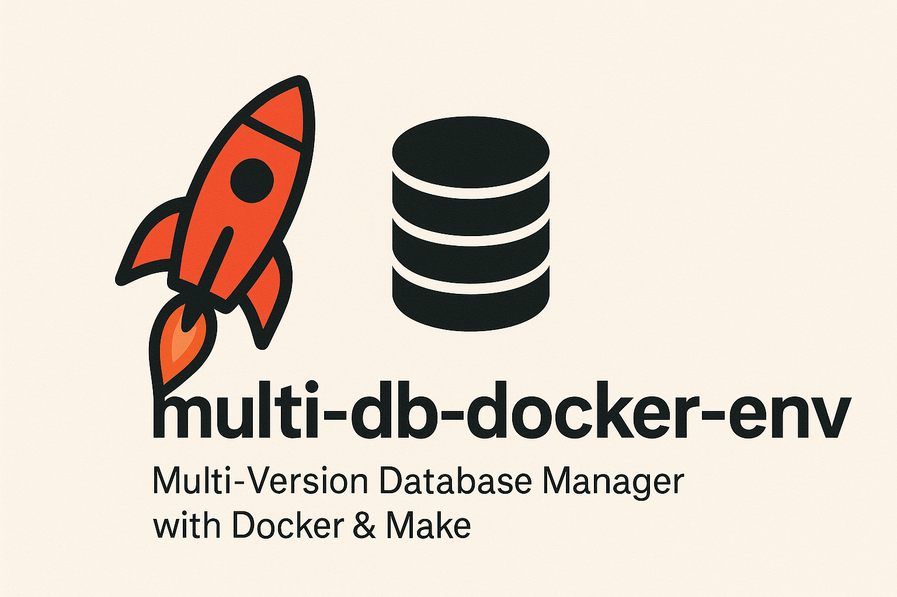
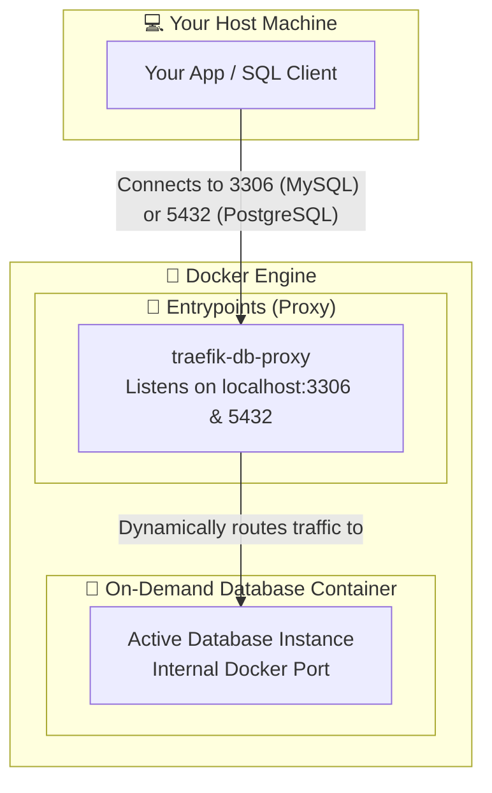
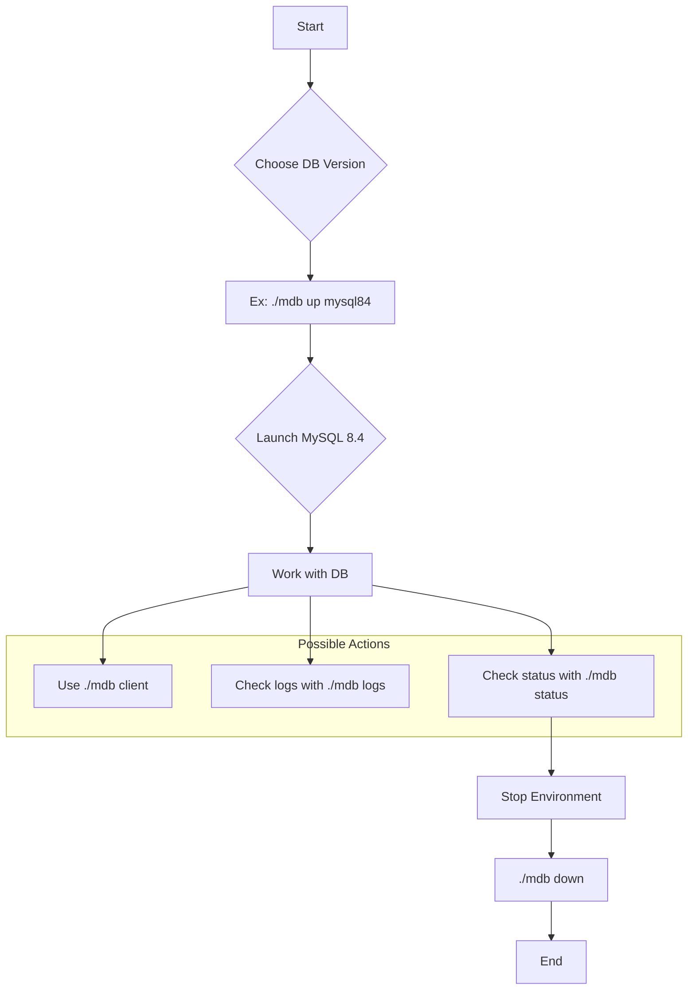

| MariaDB | MySQL | Percona | PostgreSQL | MongoDB | Traefik | Docker |
| :---: | :---: | :---: | :---: | :---: | :---: | :---: |
|  |  |  |  |  |  |  |

[](https://www.buymeacoffee.com/jmrenouard)

[](https://github.com/jmrenouard/multi-db-docker-env/releases/latest)
[](https://hub.docker.com/r/jmrenouard/multi-db-docker-env)
[](LICENSE)


The **Traefik reverse proxy** routes traffic to the active database container. Connect through stable host ports: `localhost:3306` (MySQL and MariaDB) or `localhost:5432` (PostgreSQL).

> [!IMPORTANT]
> **English-Only Policy**: All technical comments within code, configuration files, and documentation in this project MUST be in English ONLY.

## 🛰️ Verification Status

| Tier | Tier Name | Last Verified | Status |
| :--- | :--- | :--- | :--- |
| **T2** | **Standalone Matrix** | 2026-11-21 | ✅ 11/11 Active Profiles Verified Live E2E |
| **T3** | **Cluster, HA & Multi-Master (`v2.6.2`)** | 2026-11-21 | ✅ 20/20 Active Clusters Verified Live E2E (31/31 Total, Self-Contained Patroni) |
| **IMG** | **E2E Docker Image Inventory** | 2026-11-21 | ✅ 31/31 Images (`7` Custom + `24` Upstream) with `./mdb images check` |

## 📋 Prerequisites

Run `./mdb doctor` (`mdb.cmd doctor` on Windows) to verify workstation prerequisites:

* [Docker](https://docs.docker.com/get-docker/) & [Docker Compose v2](https://docs.docker.com/compose/install/) (Docker Desktop on Windows/macOS)
* `./mdb` (`mdb.cmd` on Windows): runs `bin/mdb` if prebuilt, else falls back automatically to [Go](https://go.dev/) (`>= 1.22`)
* **macOS**: Docker Desktop + Homebrew tools (`brew install go bash openssl git python`)
* **Windows**: Run `mdb.cmd` natively in PowerShell or CMD. Use **WSL2**, **Git Bash**, or `choco install make` for `make` wrappers and bash tests.
* Full cross-platform dependency list: [`PREREQUISITES.txt`](PREREQUISITES.txt).

## ⚙️ Initial Setup

1. *(Recommended)* Copy `.env.example` to `.env` (`cp .env.example .env`) and set `DB_ROOT_PASSWORD` (no quotes):

    ```env
    # File: .env
    DB_ROOT_PASSWORD=your_super_secret_password
    ```

> [!NOTE]
> If `.env` is absent, `./mdb` and `Makefile` default to `DB_ROOT_PASSWORD=rootpass` with a warning instead of failing. Existing `~/.my.cnf` files are backed up to `~/.my.cnf.bak` (`0600`).

## ✨ Single Unified Entry Point: `./mdb` (`mdb.cmd` on Windows)

`./mdb` (`mdb.cmd` on Windows) is the **single unified entry point** for all operations. `Makefile`, `interactive_runner.py`, and `mysql_docker.py` act as thin compatibility wrappers and legacy helpers delegating to `./mdb`.

### General Commands

| Command | Description | Example |
| :--- | :--- | :--- |
| `./mdb help` | Displays categorized CLI usage (`--help`, `-h`). | `./mdb help` |
| `./mdb catalog` | Lists 31 active + 5 EOL envs (`--category`, `--engine`, `--eol`, `--all`, `--json`). | `./mdb catalog --all` |
| `./mdb up <env>` | Starts standalone/cluster (auto-PKI, rejects EOL; `start` defaults `mariadb114`). | `./mdb up mysql84` |
| `./mdb setup <env>` | Runs topology setup script on demand (no-op if none). | `./mdb setup yt-cluster` |
| `./mdb down [env\|all]` | Stops specified env or all active compose stacks (`alias`: `stop`). | `./mdb down` |
| `./mdb status` / `info` | Shows active containers across all stacks (`--json`) + recent logs. | `./mdb status` |
| `./mdb logs [env\|svc]` | Streams or tails container logs (`--tail N`, `-f`). | `./mdb logs galera` |
| `./mdb client` / `mycnf` | Engine-aware shell (`mariadb`/`psql`/`mongosh`/etc.) or `~/.my.cnf` + `.bak`. | `./mdb client` |
| `./mdb interactive` | Native bilingual (`en`/`fr`) wizard (`-a`, `-i`, `-l en\|fr`; `alias`: `wizard`). | `./mdb interactive -l en` |
| `./mdb lint` / `test` | Lints `.sh` + 21 compose YAML; runs Go verifier (`--suite` runs `tests/test_<env>.sh`). | `./mdb lint` |
| `./mdb bench` / `doctor` | Multi-engine benchmarks (`bench`) and host dependency diagnostics (`doctor`). | `./mdb doctor` |
| `./mdb pki` / `report` | Native x509 cert gen/verify (`pki`) and JSON/HTML telemetry (`report`). | `./mdb pki verify all` |
| `./mdb images` | Lists (`--json`), builds (`all\|mariadb\|bucardo\|patroni\|bench`), pulls (`all\|standalone\|clusters\|helpers`), and checks all 31 E2E images. | `./mdb images check` |

> **Wrappers**: `make help|catalog|status|info|stop|client|mycnf|doctor|interactive|lint` and `make build-images|pull-images|check-images` (optional `TARGET=<group>`) delegate to `./mdb`.

### Data Management

Use these commands to inject sample databases into an active service or to run tests across all services.

| Command                            | Icon | Description                                                                                                                              | Example Usage                                    |
| :--------------------------------- | :--- | :--------------------------------------------------------------------------------------------------------------------------------------- | :----------------------------------------------- |
| `make inject`                      | 💉   | Alias for `inject-employees` on the active environment. detect correctly Galera or Replication.                                            | `make inject`                                    |
| `make inject-employees`            | 💉   | Injects `employees` database with auto-detection of environment.                                                                         | `make inject-employees`                          |
| `make inject-sakila`               | 💉   | Injects `sakila` database with auto-detection of environment.                                                                            | `make inject-sakila`                             |
| `make inject-data`                 | 💉   | Injects a sample database (`employees` or `sakila`) into a specified running service.                                                      | `make inject-data service=mysql84 db=employees`  |
| `make sync-test-db`               | 🔄   | Synchronizes the `test_db` submodule with the remote master branch.                                                                       | `make sync-test-db`                             |
| `make test-all`                    | 🧪   | Runs a full test suite: starts each DB service (MySQL, MariaDB, Percona, PostgreSQL), identifies readiness, and verifies connectivity. | `make test-all`                                  |

### Starting a Database Instance

Run `make <database_version>` to start a database instance. The Makefile stops any active database instance before it starts the new one.

###  MySQL

| Command         | Icon | Description              |
| :-------------- | :--- | :----------------------- |
| `make mysql97`  | 🐬   | Starts MySQL 9.7 LTS     |
| `make mysql84`  | 🐬   | Starts MySQL 8.4 LTS     |

###  MariaDB

| Command            | Icon | Description                |
| :----------------- | :--- | :------------------------- |
| `make mariadb123`  | 🐧   | Starts MariaDB 12.3 LTS    |
| `make mariadb118`  | 🐧   | Starts MariaDB 11.8 LTS    |
| `make mariadb114`  | 🐧   | Starts MariaDB 11.4 LTS    |
| `make mariadb1011` | 🐧   | Starts MariaDB 10.11 LTS   |

###  Percona Server

| Command          | Icon | Description                   |
| :--------------- | :--- | :---------------------------- |
| `make percona84` | ⚡   | Starts Percona Server 8.4 LTS |

###  PostgreSQL

| Command           | Icon | Description            |
| :---------------- | :--- | :--------------------- |
| `make postgres18` | 🐘   | Starts PostgreSQL 18   |
| `make postgres17` | 🐘   | Starts PostgreSQL 17   |
| `make postgres16` | 🐘   | Starts PostgreSQL 16   |
| `make postgres15` | 🐘   | Starts PostgreSQL 15   |

> [!NOTE]
> **End-of-Life (EOL) Decommissioning**: MySQL 5.7, MySQL 8.0, MySQL 9.6, MariaDB 10.6, Percona Server 8.0, Traefik v2.11, and HAProxy 2.9 have reached official community EOL and have been decommissioned. See the full [Supported Products & Decommissioned EOL Matrix](documentation/supported_products.md#-decommissioned-versions-end-of-life) for official EOL dates and recommended replacements.

## 🏗️ Technical Environment

### 🌐 Networking

The project uses standardized private subnets for cluster isolation:

* **Galera Cluster**: `10.6.0.0/24`
* **Replication Cluster**: `10.5.0.0/24`
* **PgPool-II Cluster**: `10.8.0.0/24`
* **InnoDB Cluster**: `10.9.0.0/24`
* **MongoDB ReplicaSet**: `10.10.0.0/24`
* **Patroni Cluster**: Docker bridge (auto-assigned)

These ranges are consistent across `docker-compose` configurations and internal orchestration scripts.

### 🔐 Credentials

Default credentials live in the `.env` file as `DB_ROOT_PASSWORD`.

* **Default User**: `root`
* **Default Database**: `employees` (after injection)

**MariaDB Clusters (Galera & Replication)**

Advanced MariaDB architectures with synchronous clustering or master/slave replication.

| Command            | Icon | Description                                   |
| :----------------- | :--- | :-------------------------------------------- |
| `make up-galera`   | 🌐   | Starts MariaDB Galera Cluster (3 nodes)       |
| `make up-repli`    | 🔄   | Starts MariaDB Replication Cluster (3 nodes)  |
| `make test-galera` | 🧪   | Runs functional tests on Galera               |
| `make test-repli`  | 🧪   | Runs functional tests on Replication          |

> [!NOTE]
> MariaDB clusters use a custom `mariadb_ssh` image and have dedicated ports (e.g., 3511-3513 for Galera, 3411-3413 for Replication).

**PostgreSQL HA Clusters (Patroni & PgPool-II)**

Advanced PostgreSQL architectures with automatic failover or connection pooling.

| Command              | Icon | Description                                        |
| :------------------- | :--- | :------------------------------------------------- |
| `make patroni-up`    | 🐘   | Starts Patroni HA Cluster (`mdb up patroni`)       |
| `make patroni-status`| 📊   | Shows Patroni cluster status (`mdb status patroni`)|
| `make patroni-test`  | 🧪   | Runs Patroni functional tests (`mdb test patroni`) |
| `make patroni-down`  | 🛑   | Stops Patroni cluster (`mdb down patroni`)         |
| `make pgpool-up`     | 🐘   | Starts PgPool-II Cluster (3 PG + PgPool + HAProxy)  |
| `make pgpool-status` | 📊   | Shows PgPool-II node status                        |
| `make test-pgpool`   | 🧪   | Runs PgPool-II functional tests (20 tests)         |
| `make pgpool-down`   | 🛑   | Stops PgPool-II cluster                            |

> [!NOTE]
> Patroni builds self-contained non-root images from `scripts/patroni/Dockerfile.{etcd,postgresql,haproxy}` (auto-built on `./mdb up patroni` or `./mdb images build patroni`) and uses ports 5000 (Primary RW), 5001 (Replicas RO), 7000 (HTTPS Stats), 8008 (mTLS REST API), and 2379 (etcd mTLS). PgPool-II uses ports 5100 (RW) / 5101 (RO) / 8406 (Stats).

**MySQL InnoDB Cluster (Group Replication & HAProxy)**

Advanced MySQL architecture with Group Replication and transparent routing.

| Command              | Icon | Description                                        |
| :------------------- | :--- | :------------------------------------------------- |
| `make innodb-up`     | 🐬   | Starts InnoDB Cluster (3 MySQL + HAProxy)           |
| `make innodb-status` | 📊   | Shows Group Replication status                     |
| `make test-innodb`   | 🧪   | Runs InnoDB Cluster functional tests               |
| `make innodb-down`   | 🛑   | Stops InnoDB Cluster                               |

> [!NOTE]
> InnoDB Cluster uses HAProxy ports 6446 (RW) and 6447 (RO). Stats use port 8407. Direct access uses ports 4411-4413.

**MongoDB ReplicaSet**

MongoDB architecture with ReplicaSet and HAProxy routing.

| Command              | Icon | Description                                        |
| :------------------- | :--- | :------------------------------------------------- |
| `make mongo-up`      | 🍃   | Starts MongoDB 7.0 ReplicaSet (3 nodes + HAProxy)  |
| `make mongo-status`  | 📊   | Shows MongoDB 7.0 ReplicaSet status                |
| `make test-mongo`    | 🧪   | Runs MongoDB 7.0 ReplicaSet functional tests       |
| `make mongo-down`    | 🛑   | Stops MongoDB 7.0 ReplicaSet                       |
| `make mongo8-up`     | 🍃   | Starts MongoDB 8.0 ReplicaSet (3 nodes + HAProxy)  |
| `make test-mongo8`   | 🧪   | Runs MongoDB 8.0 ReplicaSet functional tests       |
| `make mongo8-down`   | 🛑   | Stops MongoDB 8.0 ReplicaSet                       |

> [!NOTE]
> MongoDB 7.0 uses port 27100 (HAProxy), stats 8408, direct 27411-27413 (`10.10.0.0/24`). MongoDB 8.0 uses port 27200 (HAProxy), stats 8409, direct 27511-27513 (`10.11.0.0/24`). Both enforce TLS (`requireTLS`).

**PostgreSQL Replication, Multi-Master & Distributed SQL (13 Compose Stacks, `v2.1.0`–`v2.6.2`)**

All 13 PostgreSQL Compose topologies (`pg17-baseline`, `pg-streaming`, `pg-logical`, `pg-birep`, `pg18-streaming`, `pg18-logical`, `pg18-birep`, `yt-cluster`, `pgedge`, `bucardo`, `citus`, `cockroach`, `yugabyte`) expose `./mdb up|setup|test|down <stack>`, `make up-<stack>|setup-<stack>|test-<stack>|down-<stack>`, `<stack>-{up,down,status,logs,ps,test}`, `make lint`, `make test`, `make test-pg-extended` (T11–T18), `make bench-pg-v2`, `make bench-pg18`, and `make bench-yt-cluster`. For `yt-cluster` ([`dbinvent/yt:1.21.3`](https://hub.docker.com/r/dbinvent/yt), [Overview](https://dbinvent.com/30p), [`agent.md`](https://dbinvent.com/agent.md)), note the MIT ([`DBinvent/yt-cluster-lite`](https://github.com/DBinvent/yt-cluster-lite) single-DB leaf) vs PolyForm Noncommercial 1.0.0 / Commercial (`ytserv` + `ytctl`) license split and the [Jepsen report](https://dbinvent.com/cluster/articles/jepsen) (`cursor-stability`, `51` initial -> `49/49` retested). See [pg_multimaster.md](documentation/pg_multimaster.md).

**Example: Switching Databases**

```bash
./mdb up mysql84   # Start MySQL 8.4 LTS (or `make mysql84`)
./mdb up percona84 # Automatically stops mysql84 and starts Percona 8.4 LTS
./mdb status && ./mdb lint && ./mdb doctor
```

## 🏛️ Architecture

Traefik acts as a reverse proxy on host ports `3306` and `5432`. It forwards traffic to the active database instance.

<p align="center">
  
</p>



✨ **Traefik Dashboard**: To see this routing in action and inspect Traefik's configuration, open your browser and navigate to [http://localhost:8080](http://localhost:8080).

## 📁 Project Structure

```
.
├── 📜 .env                 # Secrets file (password), to be created by you
├── 🐳 docker-compose.yml  # Defines single-instance services (Traefik, DBs)
├── 🐳 docker-compose-galera.yml # MariaDB Galera Cluster definition
├── 🐳 docker-compose-repli.yml  # MariaDB Replication Cluster definition
├── 🐳 docker-compose-patroni.yml # Patroni PostgreSQL HA Cluster
├── 🐳 docker-compose-pgpool.yml  # PgPool-II PostgreSQL Cluster
├── 🐳 docker-compose-innodb-cluster.yml # MySQL InnoDB Cluster
├── 🐳 docker-compose-mongo-rs.yml  # MongoDB 7.0 ReplicaSet
├── 🐳 docker-compose-mongo8-rs.yml # MongoDB 8.0 ReplicaSet
├── 🐳 docker-compose-pg-*.yml      # PostgreSQL streaming, logical, bi-rep, pgEdge, Citus, Bucardo, Cockroach, Yugabyte
├── 🚀 mdb / mdb.cmd        # Single unified cross-platform CLI entrypoint (Linux/macOS/Windows)
├── 🚀 cmd/mdb/             # Native Go CLI source (`main.go`, `commands_*.go`)
├── 📦 pkg/                 # Pure-Go orchestration modules (`catalog`, `interactive`, `docker`, `topology`, `bench`, `pki`, `dbclient`, `report`)
├── 📜 go.mod               # Go module definition (zero external dependencies)
├── 🏛️ docs/                # Project governance registers (`ACTION_LOGBOOK`, `RCA_REGISTER`)
├── 🛠️ Makefile             # Thin compatibility wrapper delegating to `./mdb` (plus CI/test targets)
├── 📂 documentation/      # Detailed guides for clusters and scripts
├── 📂 reports/            # Performance and test reports
├── 📚 [INDEX.md](documentation/INDEX.md) # Documentation Index
├── 📖 README.md           # This file (English documentation)
└── 📖 README_fr.md        # French version of this file
```

## 📚 Documentation

For detailed information on specific components, please refer to the following guides:

* **[Documentation Index](documentation/INDEX.md)**: Main entry point for all documentation.
* **[Architecture](documentation/architecture.md)**: Network layout and topology.
* **[Makefile Reference](documentation/makefile.md)**: Comprehensive list of all available commands.
* **[Utility Scripts](documentation/scripts.md)**: Backup, restore, and setup script details.
* **[PostgreSQL Support](documentation/postgresql_support.md)**: Standalone, Patroni HA, and PgPool-II clusters.
* **[PostgreSQL Multi-Master & Distributed SQL](documentation/pg_multimaster.md)**: `pg-streaming`, `pg-logical`, `pg-birep`, `pgedge`, `bucardo`, `citus`, `cockroach`, `yugabyte`, T11–T18 matrix, and V2 benchmarks.
* **[Patroni Cluster](documentation/patroni_cluster.md)**: PostgreSQL 17 HA with ETCD and automatic failover.
* **[PgPool-II Cluster](documentation/pgpool_cluster.md)**: Connection pooling + load balancing.
* **[InnoDB Cluster](documentation/innodb_cluster.md)**: MySQL 8.4 LTS Group Replication + HAProxy.
* **[MongoDB ReplicaSet](documentation/mongo_replicaset.md)**: MongoDB 7.0 & 8.0 ReplicaSet + HAProxy + TLS.
* **[Test Scenarios](documentation/tests.md)**: Specific test cases and reporting instructions.
* **[Galera Bootstrap](documentation/galera_bootstrap.md)**: Detailed steps for Galera clustering.
* **[Replication Setup](documentation/replication_setup.md)**: Master/Slave configuration guide.
* **[Action Logbook](docs/ACTION_LOGBOOK.md)**: Living register of ongoing actions, completed requests, and phase milestones.
* **[RCA Register](docs/RCA_REGISTER.md)**: Transparent engineering register of RCAs, dead-ends, approximations, and future roadmap.

## 💡 Typical Workflow

Here is a diagram illustrating a common workflow:



1. **Choose and start a database version**:

    ```bash
    ./mdb up mysql84
    ```

2. **(Optional but Recommended)** Generate your `~/.my.cnf` for easy client access:

    ```bash
    ./mdb mycnf
    ```

3. **Connect using your preferred SQL client** to `localhost:3306` or use the engine-aware shell:

    ```bash
    ./mdb client
    ```

4. **Develop and test** against the database.
5. **Check logs** if needed:

    ```bash
    ./mdb logs
    ```

6. **Switch to another database version** if required:

    ```bash
    ./mdb up mariadb114
    ```

7. When done, **stop the environment**:

    ```bash
    ./mdb down
    ```

## 🚀 Go `mdb` CLI Build & Testing (`v2.6.2`)

A native CLI (`./mdb`, `mdb.cmd`, `cmd/mdb`, `bin/mdb`) written in pure Go (zero external dependencies). See [General Commands](#general-commands) above for the full subcommand matrix.

```bash
make build-go    # Optional: build bin/mdb (./mdb auto-falls back to go run ./cmd/mdb)
make test-go     # Run Go test suite across all 11 packages
```

## 🚀 Release Pipeline (GitHub Actions)

Automated releases run from [`.github/workflows/release.yml`](.github/workflows/release.yml) on `v*.*.*` tag pushes or manual `workflow_dispatch`. Dry-run mode runs by default, and `publish=true` publishes the release.

1. **Validate**: Checks `VERSION`, `Changelog`, and tags with [`scripts/release_notes.py`](scripts/release_notes.py), then runs Python `unittest`, `go test -race ./...`, and `tests/test_config.sh`.
2. **Build & Package**: Cross-compiles `cmd/mdb` for 6 targets (`linux`/`darwin`/`windows` × `amd64`/`arm64`) with `-ldflags` version injection, packages lab `.tar.gz`/`.zip` bundles, and generates `SHA256SUMS.txt`.
3. **Publish**: Extracts `Changelog` notes and publishes the GitHub Release with binaries and checksums. Pushes multi-arch Docker Hub images when secrets exist.

## 📜 Project Governance & Living Registers

Maintenance follows strict governance rules in [`AGENTS.md`](AGENTS.md):
- **English-Only Policy**: All code, docs, commits, PRs, and issues in English.
- **PR Diff Limit**: Strictly under 15,000 characters per PR.
- **Action Logbook ([`docs/ACTION_LOGBOOK.md`](docs/ACTION_LOGBOOK.md))**: Every action tracked under Ongoing or Completed.
- **RCA Register ([`docs/RCA_REGISTER.md`](docs/RCA_REGISTER.md))**: Traceability for Errors (RCA), Dead-Ends (IMP), Approximations (APP), Roadmap (IDEA).

## 🔧 Troubleshooting & Performance Notes

### `io_uring` EPERM Warning Fallback

When MySQL or MariaDB containers start on Linux hosts with `kernel.io_uring_disabled=2`, container logs can show:

```text
io_uring_queue_init() failed with EPERM — kernel has io_uring_disabled=2.
```

- **Impact**: No functional issues or failures occur. Database engines automatically and transparently fall back to `libaio` for asynchronous I/O operations.
- **Action Required**: None required for standard local development or testing.
- **Maximum Performance Tuning (Optional)**: If you require `io_uring` I/O performance, enable it on your Linux host:

  ```bash
  sudo sysctl -w kernel.io_uring_disabled=0
  ```

  To make this setting persistent across reboots, append `kernel.io_uring_disabled = 0` to `/etc/sysctl.conf`.

