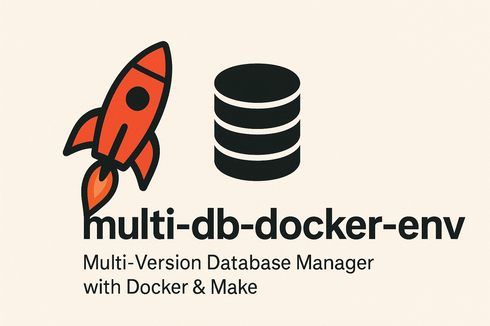
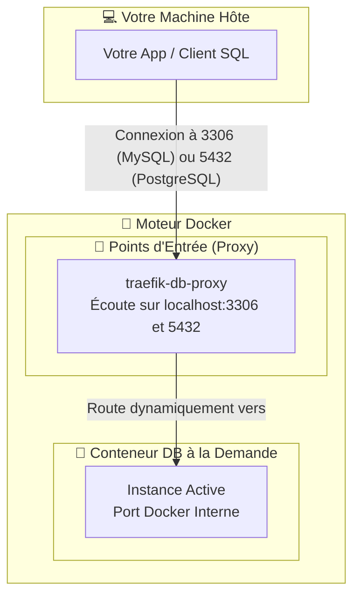
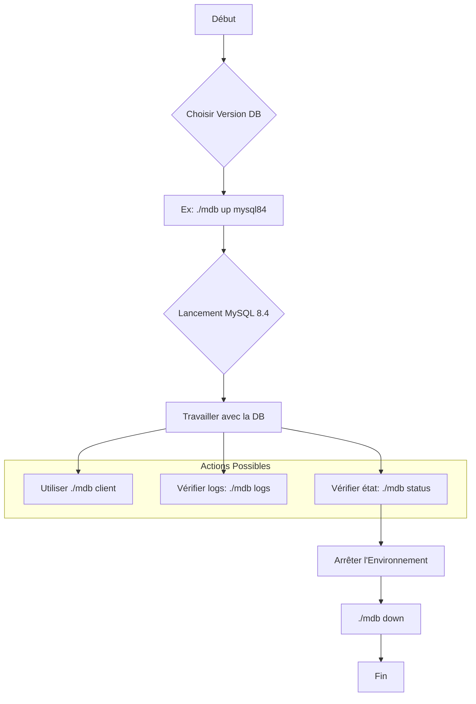

<p align="center">
  
  
  
  
  
  
  
</p>

[](https://www.buymeacoffee.com/jmrenouard)

<p align="center">
  <a href="https://github.com/jmrenouard/multi-db-docker-env/releases/latest"></a>
  <a href="https://hub.docker.com/r/jmrenouard/multi-db-docker-env"></a>
  <a href="LICENSE"></a>
</p>

Une fonctionnalité clé est le **proxy inverse Traefik**, qui garantit que toutes les instances de base de données sont accessibles via des ports stables sur votre machine hôte (`localhost:3306` pour MySQL/MariaDB et `localhost:5432` pour PostgreSQL), quelle que soit la version spécifique de la base de données que vous choisissez d'exécuter.

> [!IMPORTANT]
> **Politique d'Anglais Uniquement** : Tous les commentaires techniques dans le code, les fichiers de configuration et la documentation de ce projet DOIVENT être en anglais UNIQUEMENT.

## 🛰️ État de Vérification

| Niveau | Nom du Niveau | Dernière Vérification | État |
| :--- | :--- | :--- | :--- |
| **T2** | **Matrice Standalone** | 2026-11-21 | ✅ 11/11 Profils Actifs Vérifiés E2E |
| **T3** | **Cluster, HA & Multi-Maître (`v2.6.1`)** | 2026-11-21 | ✅ 20/20 Clusters Actifs Vérifiés E2E (31/31 Total, Patroni Autonome) |
| **IMG** | **Inventaire Images Docker E2E** | 2026-11-21 | ✅ 31/31 Images (`7` Custom + `24` Upstream) via `./mdb images check` |

## 📋 Prérequis

Exécutez `./mdb doctor` (`mdb.cmd doctor` sous Windows) pour vérifier vos prérequis :

* [Docker](https://docs.docker.com/get-docker/) & [Docker Compose v2](https://docs.docker.com/compose/install/) (Docker Desktop sous Windows/macOS)
* `./mdb` (`mdb.cmd` sous Windows) : exécute `bin/mdb` si compilé, ou bascule automatiquement vers [Go](https://go.dev/) (`>= 1.22`) via `go run ./cmd/mdb`
* **macOS** : Docker Desktop + outils Homebrew (`brew install go bash openssl git python`)
* **Windows** : exécutez `mdb.cmd` nativement dans PowerShell/CMD ; utilisez **WSL2** ou **Git Bash** (ou `choco install make`) pour les wrappers `make` et les tests bash
* Liste complète multi-OS : voir [`PREREQUISITES.txt`](PREREQUISITES.txt).

## ⚙️ Configuration Initiale

1. *(Recommandé)* Copiez `.env.example` vers `.env` (`cp .env.example .env`) et définissez `DB_ROOT_PASSWORD` (sans guillemets) :

    ```env
    # Fichier : .env
    DB_ROOT_PASSWORD=your_super_secret_password
    ```

> [!NOTE]
> Si `.env` est absent, `./mdb` et `Makefile` utilisent par défaut `DB_ROOT_PASSWORD=rootpass` avec un avertissement au lieu d'échouer. Tout `~/.my.cnf` existant est sauvegardé vers `~/.my.cnf.bak` (`0600`).

## ✨ Point d'Entrée Unique Unifié : `./mdb` (`mdb.cmd` sous Windows)

`./mdb` (`mdb.cmd` sous Windows) est le **point d'entrée unique unifié** pour toutes les opérations. `Makefile`, `interactive_runner.py` et `mysql_docker.py` servent de wrappers de compatibilité et d'helpers historiques déléguant à `./mdb`.

### Commandes Générales

| Commande | Description | Exemple |
| :--- | :--- | :--- |
| `./mdb help` | Affiche l'aide CLI catégorisée (`--help`, `-h`). | `./mdb help` |
| `./mdb catalog` | Liste les 31 environnements actifs + 5 EOL (`--category`, `--engine`, `--eol`, `--all`, `--json`). | `./mdb catalog --all` |
| `./mdb up <env>` | Démarre un profil standalone ou cluster (auto-PKI, rejette EOL ; `start` défaut `mariadb114`). | `./mdb up mysql84` |
| `./mdb setup <env>` | Exécute le script de configuration d'une topologie à la demande. | `./mdb setup yt-cluster` |
| `./mdb down [env\|all]` | Arrête l'environnement ciblé ou toutes les piles actives (`alias` : `stop`). | `./mdb down` |
| `./mdb status` / `info` | Affiche les conteneurs actifs sur toutes les piles (`--json`) + logs récents. | `./mdb status` |
| `./mdb logs [env\|svc]` | Affiche ou suit les logs des conteneurs (`--tail N`, `-f`). | `./mdb logs galera` |
| `./mdb client` / `mycnf` | Shell adaptatif (`mariadb`/`psql`/`mongosh`/etc.) ou `~/.my.cnf` + `.bak` (`0600`). | `./mdb client` |
| `./mdb interactive` | Assistant bilingue natif (`-a`, `-i`, `-l en\|fr` ; `alias` : `wizard`). | `./mdb interactive -l fr` |
| `./mdb lint` / `test` | Valide `.sh` + 21 Compose YAML ; lance le vérifieur Go (`--suite` exécute `tests/test_<env>.sh`). | `./mdb lint` |
| `./mdb bench` / `doctor` | Benchmarks multi-moteurs (`bench`) et diagnostic des dépendances (`doctor`). | `./mdb doctor` |
| `./mdb pki` / `report` | Certificats TLS x509 natifs (`pki`) et rapports JSON/HTML (`report`). | `./mdb pki verify all` |
| `./mdb images` | Liste (`--json`), construit (`all\|mariadb\|bucardo\|patroni\|bench`), télécharge (`all\|standalone\|clusters\|helpers`) et vérifie les 31 images E2E. | `./mdb images check` |

> **Wrappers** : `make help|catalog|status|info|stop|client|mycnf|doctor|interactive|lint` et `make build-images|pull-images|check-images` (`TARGET=<groupe>` optionnel) délèguent à `./mdb`. `interactive_runner.py` et `mysql_docker.py` affichent des bannières de migration vers `./mdb`.

### Gestion des Données

Ces commandes permettent d'injecter des exemples de bases de données ou d'exécuter une suite de tests complète.

| Command                 | Icon | Description                                                                                                          | Exemple d'utilisation                            |
| :---------------------- | :--- | :------------------------------------------------------------------------------------------------------------------- | :----------------------------------------------- |
| `make inject`           | 💉   | Alias pour `inject-employees` sur l'environnement actif. Détecte Galera ou Réplication.                              | `make inject`                                   |
| `make inject-employees` | 💉   | Injecte la base `employees` avec auto-détection de l'environnement.                                                 | `make inject-employees`                         |
| `make inject-sakila`    | 💉   | Injecte la base `sakila` avec auto-détection de l'environnement.                                                    | `make inject-sakila`                            |
| `make inject-data`      | 💉   | Injecte une base (`employees` ou `sakila`) dans un service spécifique en cours d'exécution.                         | `make inject-data service=mysql84 db=employees` |
| `make sync-test-db`     | 🔄   | Synchronise le sous-module `test_db` avec la branche master distante.                                               | `make sync-test-db`                             |
| `make test-all`         | 🧪   | Exécute une suite de tests complète : démarre chaque service (MySQL, MariaDB, Percona, PostgreSQL), vérifie la disponibilité et la connectivité. | `make test-all`                                 |

### Démarrage d'une Instance de Base de Données

Pour démarrer une version spécifique, utilisez `make <version_db>`. Le Makefile arrêtera automatiquement toute instance en cours avant de lancer la nouvelle.

###  MySQL

| Command        | Icon | Description           |
| :------------- | :--- | :-------------------- |
| `make mysql97` | 🐬   | Démarre MySQL 9.7 LTS |
| `make mysql84` | 🐬   | Démarre MySQL 8.4 LTS |

###  MariaDB

| Command            | Icon | Description               |
| :----------------- | :--- | :------------------------ |
| `make mariadb123`  | 🐧   | Démarre MariaDB 12.3 LTS  |
| `make mariadb118`  | 🐧   | Démarre MariaDB 11.8 LTS  |
| `make mariadb114`  | 🐧   | Démarre MariaDB 11.4 LTS  |
| `make mariadb1011` | 🐧   | Démarre MariaDB 10.11 LTS |

###  Percona Server

| Command          | Icon | Description                 |
| :--------------- | :--- | :-------------------------- |
| `make percona84` | ⚡   | Démarre Percona 8.4 LTS     |

###  PostgreSQL

| Command            | Icon | Description             |
| :----------------- | :--- | :---------------------- |
| `make postgres18`  | 🐘   | Démarre PostgreSQL 18   |
| `make postgres17`  | 🐘   | Démarre PostgreSQL 17   |
| `make postgres16`  | 🐘   | Démarre PostgreSQL 16   |
| `make postgres15`  | 🐘   | Démarre PostgreSQL 15   |

> [!NOTE]
> **Décommissionnement Fin de Vie (EOL)** : MySQL 5.7, MySQL 8.0, MySQL 9.6, MariaDB 10.6, Percona Server 8.0, Traefik v2.11 et HAProxy 2.9 ont atteint leur fin de vie officielle communautaire et ont été décommissionnés. Consultez la [Matrice des Produits Supportés & Versions Décommissionnées](documentation/supported_products_fr.md#versions-décommissionnées-fin-de-vie--eol) pour les dates EOL exactes et les remplacements recommandés.

## 🏗️ Environnement Technique

### 🌐 Réseautage

Le projet utilise des sous-réseaux privés standardisés pour l'isolation des clusters :

* **Cluster Galera** : `10.6.0.0/24`
* **Cluster de Réplication** : `10.5.0.0/24`
* **Cluster PgPool-II** : `10.8.0.0/24`
* **InnoDB Cluster** : `10.9.0.0/24`
* **MongoDB ReplicaSet** : `10.10.0.0/24`
* **Cluster Patroni** : Docker bridge (auto-assigné)

Ces plages sont cohérentes entre les configurations `docker-compose` et les scripts d'orchestration internes.

### 🔐 Identifiants

Les identifiants par défaut sont centralisés dans le fichier `.env` via `DB_ROOT_PASSWORD`.

* **Utilisateur par défaut** : `root`
* **Base de données par défaut** : `employees` (après injection)

### Clusters MariaDB (Galera & Réplication)

Architectures MariaDB avancées avec clustering synchrone ou réplication maître/esclave.

| Command            | Icon | Description                                    |
| :----------------- | :--- | :--------------------------------------------- |
| `make up-galera`   | 🌐   | Démarre le cluster Galera (3 nœuds)            |
| `make up-repli`    | 🔄   | Démarre le cluster de Réplication (3 nœuds)    |
| `make test-galera` | 🧪   | Exécute les tests fonctionnels sur Galera      |
| `make test-repli`  | 🧪   | Exécute les tests fonctionnels sur Réplication |

> [!NOTE]
> Les clusters MariaDB utilisent une image personnalisée `mariadb_ssh` et ont des ports dédiés (ex: 3511-3513 pour Galera).

### Clusters PostgreSQL HA (Patroni & PgPool-II)

Architectures PostgreSQL avancées avec failover automatique ou pooling de connexions.

| Commande             | Icon | Description                                            |
| :------------------- | :--- | :----------------------------------------------------- |
| `make patroni-up`    | 🐘   | Démarre le cluster Patroni HA (3 PG + 3 ETCD + HAProxy) |
| `make patroni-status`| 📊   | Affiche le statut du cluster Patroni                    |
| `make test-patroni`  | 🧪   | Exécute les tests fonctionnels Patroni                  |
| `make patroni-down`  | 🛑   | Arrête le cluster Patroni                               |
| `make pgpool-up`     | 🐘   | Démarre le cluster PgPool-II (3 PG + PgPool + HAProxy)  |
| `make pgpool-status` | 📊   | Affiche le statut des nœuds PgPool-II                   |
| `make test-pgpool`   | 🧪   | Exécute les tests PgPool-II (20 tests)                  |
| `make pgpool-down`   | 🛑   | Arrête le cluster PgPool-II                             |

> [!NOTE]
> Patroni construit ses images autonomes non-root depuis `scripts/patroni/Dockerfile.{etcd,postgresql,haproxy}` (construction auto via `./mdb up patroni` ou `./mdb images build patroni`) et utilise les ports 5000 (RW) / 5001 (RO) / 7000 (Stats HTTPS) / 8008 (REST API mTLS) / 2379 (etcd mTLS). PgPool-II utilise les ports 5100 (RW) / 5101 (RO) / 8406 (Stats).

### MySQL InnoDB Cluster (Group Replication & HAProxy)

Architecture MySQL avancée avec Group Replication et routage transparent.

| Commande             | Icon | Description                                            |
| :------------------- | :--- | :----------------------------------------------------- |
| `make innodb-up`     | 🐬   | Démarre InnoDB Cluster (3 MySQL + HAProxy)              |
| `make innodb-status` | 📊   | Affiche le statut Group Replication                    |
| `make test-innodb`   | 🧪   | Exécute les tests InnoDB Cluster                        |
| `make innodb-down`   | 🛑   | Arrête InnoDB Cluster                                   |

> [!NOTE]
> InnoDB Cluster utilise les ports 6446 (RW) / 6447 (RO) via HAProxy. Stats : 8407. Accès direct : 4411-4413.

### MongoDB ReplicaSet

Architecture MongoDB avec ReplicaSet et routage HAProxy.

| Commande             | Icon | Description                                            |
| :------------------- | :--- | :----------------------------------------------------- |
| `make mongo-up`      | 🍃   | Démarre MongoDB 7.0 ReplicaSet (3 nœuds + HAProxy)     |
| `make mongo-status`  | 📊   | Affiche le statut du ReplicaSet MongoDB 7.0            |
| `make test-mongo`    | 🧪   | Exécute les tests MongoDB 7.0 ReplicaSet               |
| `make mongo-down`    | 🛑   | Arrête MongoDB 7.0 ReplicaSet                          |
| `make mongo8-up`     | 🍃   | Démarre MongoDB 8.0 ReplicaSet (3 nœuds + HAProxy)     |
| `make test-mongo8`   | 🧪   | Exécute les tests MongoDB 8.0 ReplicaSet               |
| `make mongo8-down`   | 🛑   | Arrête MongoDB 8.0 ReplicaSet                          |

> [!NOTE]
> MongoDB 7.0 utilise le port 27100 (HAProxy), stats 8408, accès direct 27411-27413 (`10.10.0.0/24`). MongoDB 8.0 utilise le port 27200 (HAProxy), stats 8409, accès direct 27511-27513 (`10.11.0.0/24`). Les deux imposent TLS (`requireTLS`).

### PostgreSQL Réplication, Multi-Maître & SQL Distribué (13 Piles Compose, `v2.1.0`–`v2.5.0`)

Les 13 piles PostgreSQL Compose (`pg17-baseline`, `pg-streaming`, `pg-logical`, `pg-birep`, `pg18-streaming`, `pg18-logical`, `pg18-birep`, `yt-cluster`, `pgedge`, `bucardo`, `citus`, `cockroach`, `yugabyte`) exposent `./mdb up|setup|test|down <pile>`, `make up-<pile>|setup-<pile>|test-<pile>|down-<pile>`, `<pile>-{up,down,status,logs,ps,test}`, `make lint`, `make test`, `make test-pg-extended` (T11–T18), `make bench-pg-v2`, `make bench-pg18` et `make bench-yt-cluster`. Pour `yt-cluster` ([`dbinvent/yt:1.21.3`](https://hub.docker.com/r/dbinvent/yt), [Présentation](https://dbinvent.com/30p), [`agent.md`](https://dbinvent.com/agent.md)), notez la séparation de licence MIT ([`DBinvent/yt-cluster-lite`](https://github.com/DBinvent/yt-cluster-lite) nœud mono-BDD) vs PolyForm Noncommercial 1.0.0 / Commercial (`ytserv` + `ytctl`) et le [rapport Jepsen](https://dbinvent.com/cluster/articles/jepsen) (`cursor-stability`, `51` initial -> `49/49` retestées). Voir [pg_multimaster_fr.md](documentation/pg_multimaster_fr.md).

**Exemple : Changer de Base de Données**

```bash
./mdb up mysql84   # Démarre MySQL 8.4 LTS (ou `make mysql84`)
./mdb up percona84 # Arrête automatiquement mysql84 puis démarre Percona 8.4 LTS
./mdb status && ./mdb lint && ./mdb doctor
```

## 🏛️ Architecture

Le système utilise un **proxy inverse Traefik** comme routeur intelligent. C'est le seul service exposé sur le port `3306` de votre hôte et il redirige automatiquement le trafic vers l'instance de base de données active.

<p align="center">
  
</p>



✨ **Tableau de Bord Traefik** : Pour voir ce routage en action, ouvrez votre navigateur sur [http://localhost:8080](http://localhost:8080).

## 📁 Structure du Projet

```
.
├── 📜 .env                 # Fichier des secrets (mot de passe), à créer par vous
├── 🐳 docker-compose.yml  # Définit les services mono-instance (Traefik, DBs)
├── 🐳 docker-compose-galera.yml # Définition du Cluster MariaDB Galera
├── 🐳 docker-compose-repli.yml  # Définition du Cluster MariaDB Réplication
├── 🐳 docker-compose-patroni.yml # Cluster PostgreSQL HA Patroni
├── 🐳 docker-compose-pgpool.yml  # Cluster PostgreSQL PgPool-II
├── 🚀 mdb / mdb.cmd        # Point d'entrée CLI unifié multi-OS (Linux/macOS/Windows)
├── 🚀 cmd/mdb/ & pkg/      # Source Go native (`catalog`, `interactive`, `docker`, `topology`, `pki`, `dbclient`, `bench`, `report`)
├── 🛠️ Makefile             # Wrapper de compatibilité déléguant à `./mdb` (plus cibles CI/tests)
├── 📂 documentation/      # Guides détaillés pour les clusters et scripts
├── 📂 reports/            # Rapports de performance et de tests
├── 📚 [INDEX.md](documentation/INDEX.md) # Index de la documentation
├── 📖 README.md           # Ce fichier (Documentation en anglais)
└── 📖 README_fr.md        # Version française de ce fichier
```

## 📚 Documentation

Pour des informations détaillées, veuillez vous référer aux guides suivants :

* **[Index de la Documentation](documentation/INDEX_fr.md)** : Point d'entrée principal.
* **[Architecture](documentation/architecture.md)** : Schéma réseau et topologie.
* **[Référence Makefile](documentation/makefile_fr.md)** : Liste des commandes `make` (version complète : [makefile.md](documentation/makefile.md)).
* **[Scripts Utilitaires](documentation/scripts.md)** : Détails sur les scripts de backup, restauration, setup et CLI Go `mdb`.
* **[Support PostgreSQL](documentation/postgresql_support_fr.md)** : Standalone, Patroni HA, et clusters PgPool-II.
* **[PostgreSQL Multi-Maître & SQL Distribué](documentation/pg_multimaster_fr.md)** : `pg-streaming`, `pg-logical`, `pg-birep`, `pgedge`, `bucardo`, `citus`, `cockroach`, `yugabyte` et benchmarks V2.
* **[Cluster Patroni](documentation/patroni_cluster.md)** : PostgreSQL 17 HA avec ETCD et failover automatique.
* **[Cluster PgPool-II](documentation/pgpool_cluster.md)** : Pooling de connexions + load balancing.
* **[InnoDB Cluster](documentation/innodb_cluster_fr.md)** : MySQL 8.4 LTS Group Replication + HAProxy.
* **[MongoDB ReplicaSet](documentation/mongo_replicaset_fr.md)** : MongoDB 7.0 & 8.0 ReplicaSet + HAProxy + TLS.
* **[Scénarios de Test](documentation/tests_fr.md)** : Cas de test spécifiques et rapports.
* **[Produits Supportés](documentation/supported_products_fr.md)** : Matrice complète des moteurs, versions et ports.
* **[Bootstrap Galera](documentation/galera_bootstrap.md)** : Étapes détaillées pour Galera.
* **[Setup Réplication](documentation/replication_setup.md)** : Guide de configuration Maître/Esclave.
* **[Gouvernance & Registres](AGENTS.md)** : Règles du projet, [Action Logbook](docs/ACTION_LOGBOOK.md) et [RCA Register](docs/RCA_REGISTER.md).

## 💡 Flux de Travail Typique



1. **Choisissez et démarrez une version** : `./mdb catalog` puis `./mdb up mysql84` (ou `mdb.cmd up mysql84` sous Windows).
2. **(Optionnel) Générez votre `~/.my.cnf`** (avec sauvegarde `.bak` `0600`) : `./mdb mycnf`.
3. **Connectez-vous via le shell adaptatif** : `./mdb client` (`mariadb`, `psql`, `mongosh`, `cockroach` ou `ysqlsh`).
4. **Vérifiez les logs ou changez de moteur** : `./mdb logs`, `./mdb status` ou `./mdb up mariadb114`.
5. **Arrêtez tout** : `./mdb down` (ou `make stop`).

## 🚀 Pipeline de Release (GitHub Actions)

Les releases sont automatisées via [`.github/workflows/release.yml`](.github/workflows/release.yml) sur push de tag `v*.*.*` ou `workflow_dispatch` (mode dry-run par défaut ; `publish=true` pour publier) : validation `VERSION`/`Changelog` ([`scripts/release_notes.py`](scripts/release_notes.py)), tests Python/Go/config, cross-compilation de `cmd/mdb` (6 cibles + `SHA256SUMS.txt`), publication GitHub Release et push Docker Hub multi-arch conditionné aux secrets.

## 🔧 Dépannage & Notes de Performance

### Avertissement et repli `io_uring` EPERM

Lors du démarrage des conteneurs MySQL ou MariaDB sur des hôtes Linux avec des profils de sécurité noyau restreints (`kernel.io_uring_disabled=2`), les logs peuvent afficher :

```text
io_uring_queue_init() failed with EPERM — kernel has io_uring_disabled=2.
```

- **Impact** : Aucun dysfonctionnement. Le moteur de base de données bascule automatiquement et de manière transparente sur `libaio` pour l'I/O asynchrone.
- **Action requise** : Aucune pour les environnements de développement ou de test.
- **Optimisation des performances (Optionnelle)** : Si vous avez besoin des performances I/O maximales de `io_uring`, activez-le sur votre système hôte :

  ```bash
  sudo sysctl -w kernel.io_uring_disabled=0
  ```

  Pour rendre ce réglage persistant après redémarrage, ajoutez `kernel.io_uring_disabled = 0` dans `/etc/sysctl.conf`.

