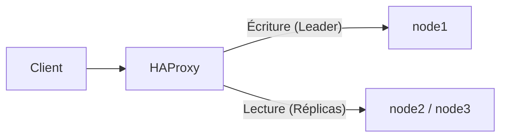

# Tutoriel 2 : Premier lab de bascule HA

Déployez un cluster PostgreSQL Patroni à trois nœuds et examinez la bascule automatique.



## Prérequis

- `./mdb doctor` validé et 4 Go de RAM libres.

## Étapes

1. Démarrez Patroni et vérifiez le leader dans `node1`.

```bash
./mdb up patroni
./mdb status patroni
docker exec node1 patronictl -c /etc/patroni.yml list
```

Sortie attendue : un nœud `Leader` et deux nœuds `Replica` (`streaming`).

2. Lancez le test automatisé de bascule puis nettoyez le lab.

```bash
bash ./tests/test_failover.sh patroni
./mdb down patroni
```

Sortie attendue : promotion validée sans erreur (`Passed`).

## Prochaine étape

Passez au [tutoriel PostgreSQL multimaître](03-lab-postgres-multimaster.md) ou à la [documentation PostgreSQL](../../documentation/postgresql_support_fr.md).
