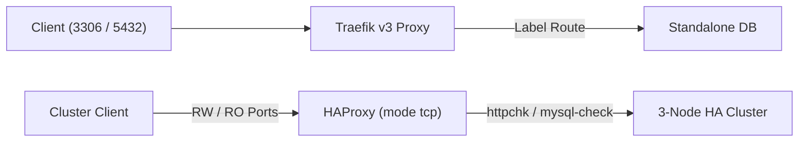

# Global Topology and Routing

Standalone Traefik routing and HAProxy cluster forwarding on one host.

## Routing Architecture

## Traefik v3 vs HAProxy Trade-Offs

| Dimension | Traefik v3 (Standalone) | HAProxy LTS (`mode tcp`) |
|---|---|---|
| Discovery | Docker labels (`traefik.enable=true`) | Static `/24` IPs or Docker DNS |
| Ports | Shared `3306` / `5432` | Dedicated RW/RO (`5000`/`5001`, `3406`/`3407`) |
| Probes | Container socket state | `httpchk` (`:8008`), `mysql-check`, `tcp-check` |
| Concurrency | One profile per port | Multiple clusters concurrently |

Traefik avoids port sprawl across 11 standalone profiles (`mysql84`–`postgres18`) at one active profile per port. HAProxy runs `mode tcp` with active probes so apps connect to fixed RW/RO ports.

## Related Documentation

- Visual topologies: [Legacy Architecture](../../../documentation/architecture.md)
- Ports and subnets: [Topology and Port Matrix](../../03-reference/architecture-specs/topology-and-port-matrix.md)
