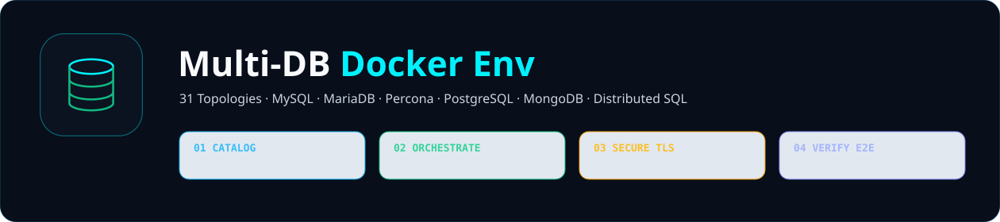

  

# Multi-DB Docker Environment

Modular Docker laboratory for standalone engines, high-availability clusters, and multi-master SQL topologies orchestrated through `./mdb` (`mdb.cmd`). Published site: [https://multi-db-docker-env.lightpath.fr/](https://multi-db-docker-env.lightpath.fr/).

  

    31 Topologies
    11 Standalone + 20 Active Clusters
  

  

    20 HA Clusters
    Galera, Patroni, InnoDB, MongoDB, CRDB, YB
  

  

    31/31 E2E Images
    7 Custom + 24 Upstream Pinned Images
  

  

    4 Diataxis Quadrants
    Tutorials, How-To, Reference, Explanation
  

[Start Tutorials](01-tutorials/index.md){ .md-button .md-button--primary }
[Browse How-To Guides](02-how-to-guides/index.md){ .md-button }
[Inspect Reference](03-reference/index.md){ .md-button }
[Read Explanation](04-explanation/index.md){ .md-button }

---

## Diataxis Matrix (Action × Cognition)

| | **Practical (Action)** | **Theoretical (Cognition)** |
| :--- | :--- | :--- |
| **Acquisition (Study)** | [**1. Tutorials (`01-tutorials/`)**](01-tutorials/index.md) Guided isolated sandbox labs | [**4. Explanation (`04-explanation/`)**](04-explanation/index.md) Routing architecture, ADRs, quorum & TLS boundaries |
| **Application (Work)** | [**2. How-To Guides (`02-how-to-guides/`)**](02-how-to-guides/index.md) ASD-STE100 Issue 9 deployment, backup, failover & PKI runbooks | [**3. Reference (`03-reference/`)**](03-reference/index.md) Ports, `.env` keys, TLS files, `./mdb` flags & error matrix |

---

## Explore Documentation by Quadrant

-   :material-school-outline:{ .lg .middle } **1. Tutorials (`01-tutorials/`)**

    ---

    *Practical · Study* — Follow reproducible local labs for standalone setup, Patroni failover, and PG 18 benchmarks.

    - [Tutorials Index](01-tutorials/index.md)
    - [1. Local Sandbox Setup](01-tutorials/01-local-sandbox-setup.md)
    - [2. First HA Failover Lab](01-tutorials/02-first-ha-failover-lab.md)
    - [3. PostgreSQL Multi-Master Lab](01-tutorials/03-postgres-multimaster-lab.md)

-   :material-wrench-outline:{ .lg .middle } **2. How-To Guides (`02-how-to-guides/`)**

    ---

    *Practical · Work* — Execute ASD-STE100 Issue 9 procedures for deployment, backup/restore, incident recovery, and TLS/TDE.

    - [How-To Guides Index](02-how-to-guides/index.md)
    - [Deploy Standalone and Clusters](02-how-to-guides/deployment/deploy-standalone-and-clusters.md)
    - [Back Up, Restore, and Switch Engines](02-how-to-guides/operations/backup-restore-and-switch-engines.md)
    - [Remediate Cluster Failover and Quorum](02-how-to-guides/incident-response/remediate-cluster-failover-and-quorum.md)
    - [Configure TLS PKI and TDE Boundaries](02-how-to-guides/security/configure-tls-pki-and-tde-boundaries.md)

-   :material-table-search:{ .lg .middle } **3. Reference (`03-reference/`)**

    ---

    *Theoretical · Work* — Look up topology ports, `.env` and PKI files, `./mdb` CLI flags, and observed SQLSTATE errors.

    - [Reference Index](03-reference/index.md)
    - [Topology and Port Matrix](03-reference/architecture-specs/topology-and-port-matrix.md)
    - [Environment and TLS PKI Matrix](03-reference/configuration/environment-and-tls-matrix.md)
    - [MDB CLI and Makefile Reference](03-reference/cli-and-scripts/mdb-cli-and-makefile-reference.md)
    - [Error and Alert Matrix](03-reference/troubleshooting-codes/error-and-alert-matrix.md)

-   :material-lightbulb-outline:{ .lg .middle } **4. Explanation (`04-explanation/`)**

    ---

    *Theoretical · Study* — Understand Traefik vs HAProxy routing, unified CLI and MkDocs ADRs, and durability boundaries.

    - [Explanation Index](04-explanation/index.md)
    - [Global Topology and Routing](04-explanation/architecture-overview/global-topology-and-routing.md)
    - [ADR-001: Unified `./mdb` CLI](04-explanation/design-decisions/adr-001-unified-mdb-cli.md)
    - [ADR-002: Diataxis and Versioned MkDocs](04-explanation/design-decisions/adr-002-diataxis-versioned-mkdocs.md)
    - [Quorum, Replication, and TLS](04-explanation/deep-dives/quorum-replication-and-tls.md)

-   :material-translate:{ .lg .middle } **Bilingual EN / FR Guides**

    ---

    Access the 26 legacy English and French cluster guides and root project overviews.

    - [Legacy Index (EN)](../documentation/INDEX.md) · [Index FR](../documentation/INDEX_fr.md)
    - [Project Overview (EN)](../README.md) · [Aperçu du Projet (FR)](../README_fr.md)

-   :material-history:{ .lg .middle } **Releases & Governance**

    ---

    Track release history, ongoing actions, root-cause analyses, and live docs at [multi-db-docker-env.lightpath.fr](https://multi-db-docker-env.lightpath.fr/).

    - [Changelog](../Changelog)
    - [Action Logbook](ACTION_LOGBOOK.md)
    - [RCA Register](RCA_REGISTER.md)

