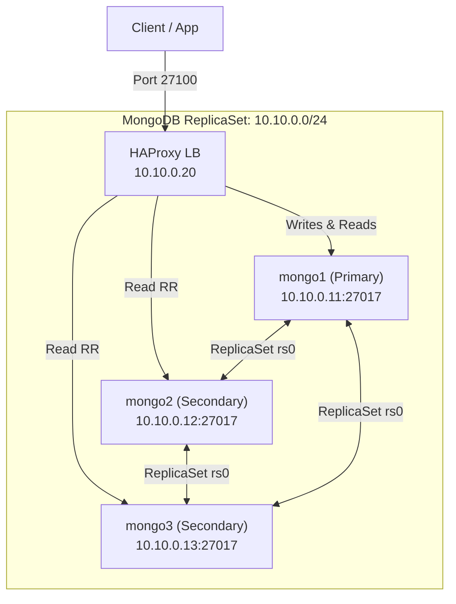

# MongoDB ReplicaSet

MongoDB 7.0 and 8.0 ReplicaSet clusters with HAProxy for connection routing and TLS encryption.

## Architecture



### Components

| Component | Image | IP | Role |
| :--- | :--- | :--- | :--- |
| `mongo1` | `mongo:7.0` | `10.10.0.11` | Primary (read/write, TLS) |
| `mongo2` | `mongo:7.0` | `10.10.0.12` | Secondary (read-only, TLS) |
| `mongo3` | `mongo:7.0` | `10.10.0.13` | Secondary (read-only, TLS) |
| `haproxy_mongo` | `haproxy:lts` | `10.10.0.20` | Connection routing (Port 27100) |
| `mongo8_n1` | `mongo:8.0` | `10.11.0.11` | Primary Mongo 8 (read/write) |
| `mongo8_n2` | `mongo:8.0` | `10.11.0.12` | Secondary Mongo 8 (read-only) |
| `mongo8_n3` | `mongo:8.0` | `10.11.0.13` | Secondary Mongo 8 (read-only) |
| `haproxy_mongo8` | `haproxy:lts` | `10.11.0.20` | Connection routing Mongo 8 (Port 27200) |

## Quick Start

### 1. Start the Cluster

```bash
make mongo-up   # MongoDB 7.0 (with TLS)
make mongo8-up  # MongoDB 8.0
```

This command:
- Starts 3 MongoDB 7.0 nodes + HAProxy
- Waits for all nodes to initialize
- Initiates the ReplicaSet (`rs.initiate()` with 3 members)
- Creates admin user with root privileges
- HAProxy auto-detects backends

### 2. Check Status

```bash
make mongo-status
make mongo-ps
make mongo-logs
make mongo8-status
```

## Connection Details

| Role | Port | Description |
| :--- | :--- | :--- |
| HAProxy RW | `27100` | Write traffic routed to primary (TLS). |
| HAProxy Stats | `8408` | HAProxy stats dashboard. |
| MongoDB Node 1 (Primary) | `27411` | Direct access to primary node (TLS). |
| MongoDB Node 2 (Secondary) | `27412` | Direct access to secondary node 2 (TLS). |
| MongoDB Node 3 (Secondary) | `27413` | Direct access to secondary node 3 (TLS). |
| HAProxy RW (Mongo 8) | `27200` | Write traffic routed to Mongo 8 primary. |
| HAProxy Stats (Mongo 8) | `8409` | HAProxy stats dashboard for Mongo 8. |
| Mongo 8 Nodes (1-3) | `27511-27513` | Direct access to Mongo 8 nodes. |

### Example Connection

```bash
# Via HAProxy (MongoDB 7.0 TLS / MongoDB 8.0)
mongosh --tls --tlsAllowInvalidCertificates --host 127.0.0.1 --port 27100
mongosh --host 127.0.0.1 --port 27200

# Direct to Primary (MongoDB 7.0 TLS / MongoDB 8.0)
mongosh --tls --tlsAllowInvalidCertificates --host 127.0.0.1 --port 27411
mongosh --host 127.0.0.1 --port 27511

# ReplicaSet connection string (MongoDB 7.0 TLS)
mongosh "mongodb://127.0.0.1:27411,127.0.0.1:27412,127.0.0.1:27413/?replicaSet=rs0&tls=true&tlsAllowInvalidCertificates=true"
```

## ReplicaSet Configuration

| Parameter | Value |
| :--- | :--- |
| ReplicaSet Name | `rs0` |
| Auth Method | keyFile (internal) |
| Primary Priority | `2` (mongo1) |
| Secondary Priority | `1` (mongo2, mongo3) |
| Write Concern | Default (majority) |

## Automated Testing

```bash
make test-mongo   # MongoDB 7.0
make test-mongo8  # MongoDB 8.0
```

Test suite validates **16 checks across 12 test groups**:

| # | Test | Description |
| :--- | :--- | :--- |
| 1 | Node Status | All 3 MongoDB nodes UP with version info |
| 2 | ReplicaSet Members | 3 active members |
| 3 | HAProxy | RW (27100) connectivity |
| 4 | Write Replication | Write on primary, verify on secondaries |
| 5 | Write Isolation | Secondaries reject writes |
| 6 | CRUD Operations | Insert, update, delete on primary |
| 7 | Version Consistency | Same MongoDB version across nodes |
| 8 | RS Config | ReplicaSet name and member count |
| 9 | Collection / Index DDL Replication | Schema validator and index replicated to secondaries |
| 10 | Concurrent Write Stress Test | 100 documents across 4 parallel workers verified on all nodes |
| 11 | TLS/SSL Status Verification | TLS mode active or certificates present on all nodes |
| 12 | Performance Micro-Benchmark | 500 document batch insertion throughput (QPS) |

Reports generated in `./reports/` (Markdown + HTML).

## Cleanup

```bash
make mongo-down   # MongoDB 7.0
make mongo8-down  # MongoDB 8.0
```

Removes all containers, networks, and volumes for a clean restart.
