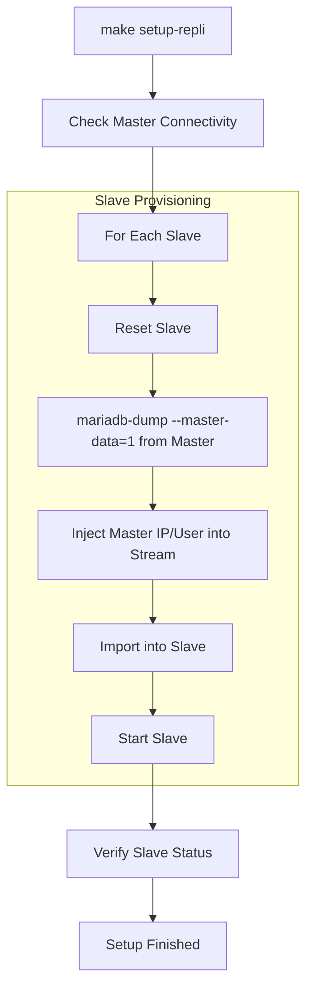

# Replication Setup Guide 🔄

Configure and verify MariaDB Master/Slave replication with `setup_repli.sh`. See [architecture.md](architecture.md) for network topology details.

## 🚀 Automation with `setup_repli.sh`

Run `make setup-repli` to execute `setup_repli.sh` and provision all replicas.

### 1. Connectivity Check

The script first verifies that the Master (Node 1 on port 3411) responds.

### 2. Slave Initialization (Repeat for Slave 1 and Slave 2)

The script runs these steps on each slave:

- **Reset**: Runs `STOP SLAVE` and `RESET SLAVE ALL` for a clean initial state.
- **Data Sync**: Runs `mariadb-dump` from the Master with `--master-data=1` and `--all-databases`.
- **Master Mapping**: Injects the Master IP (`10.5.0.11`) and replication credentials into the dump stream with `sed`.
- **Import**: Streams the dump directly into the Slave container.
- **Start**: Runs `START SLAVE`.

## ⚙️ Advanced Features

These MariaDB replication settings live in `custom_X.cnf`:

- **GTID Strict Mode**: Enables `gtid_strict_mode=1` for consistent failover.
- **Binary Log Expiration**: Sets `binlog_expire_logs_seconds=172800` (2 days).
- **Proxy Protocol**: Accepts HAProxy connections and keeps client IP addresses.

## 🛡️ Diagram: Setup Flow

## ✅ Manual Verification

After setup completes, check replication status:

1. Access a slave: `mariadb-s1` (if profiles are active).
2. Run: `SHOW SLAVE STATUS\G`
3. Check that `Slave_IO_Running` and `Slave_SQL_Running` both equal `Yes`.
